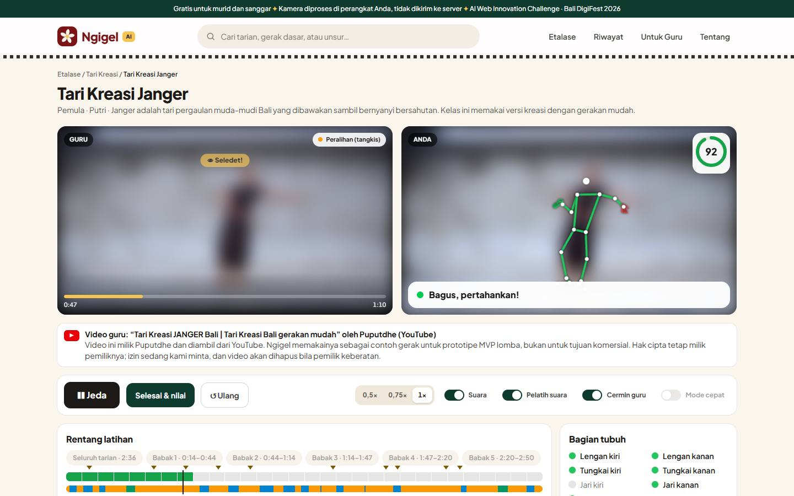
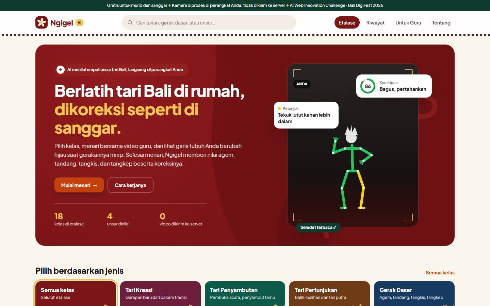
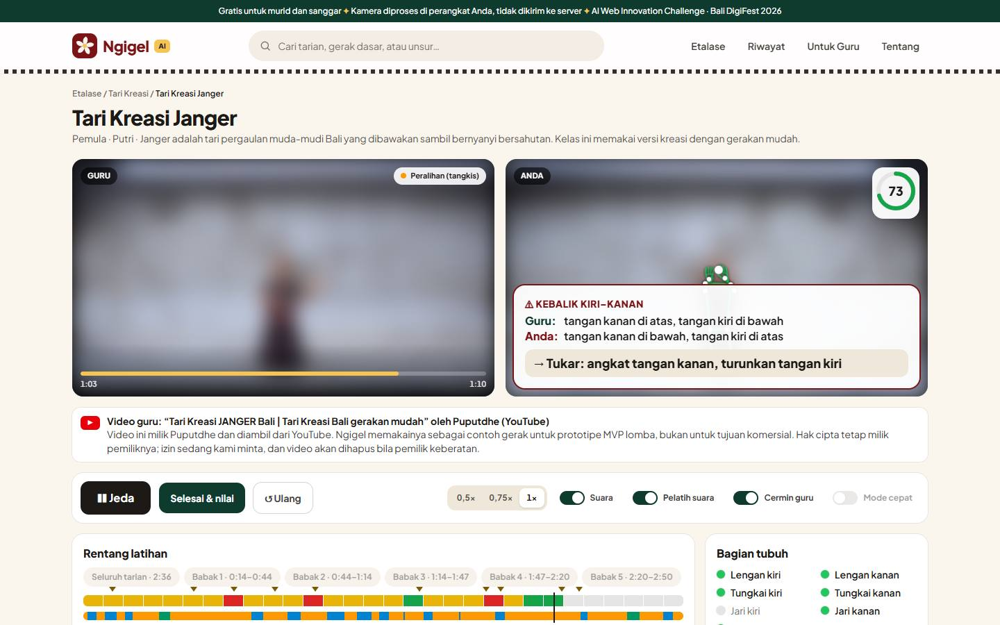
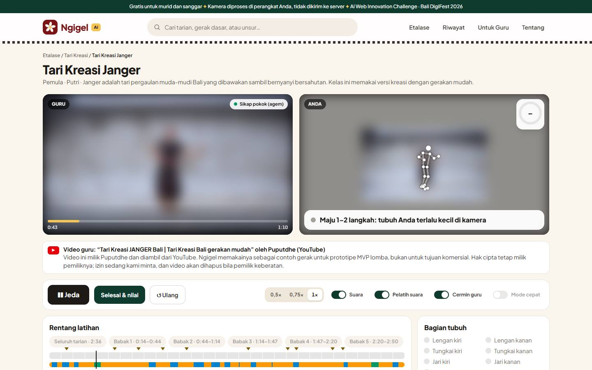
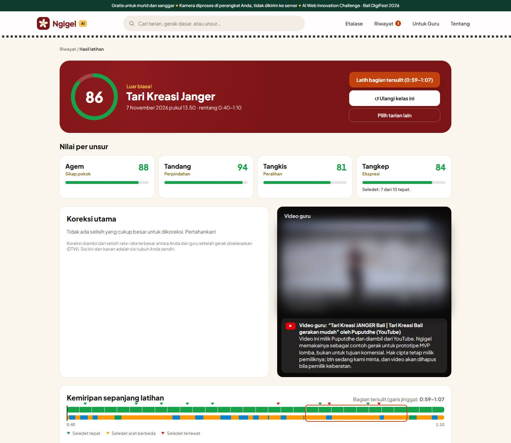
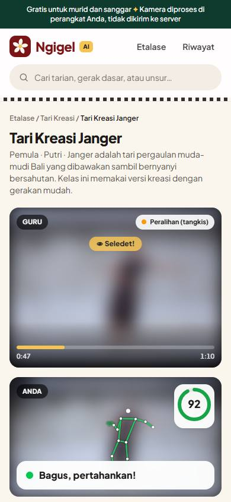

# Ngigel Pelatih Tari Bali Berbasis AI

**Berlatih tari Bali di rumah, dikoreksi seperti di sanggar.**
Murid menari di depan webcam bersama video guru. AI di peramban membaca tubuh, jari, dan lirikan mata (*seledet*), lalu memberi nilai dan koreksi menurut **empat unsur dasar tari Bali**: agem, tandang, tangkis, dan tangkep.

> AI Web Innovation Challenge Bali DigiFest 2026 · Bidang Pendidikan · Tim Sekaa Kode
> Versi yang dinilai: tag `v1.0-submission`



<sub>Semua video di tangkapan layar sengaja **diburamkan** untuk melindungi wajah penari. Garis tubuh, warna, skor, dan petunjuk adalah keluaran AI yang asli.</sub>

---

## 1. Description

Ngigel adalah **"guru yang melihat"** saat murid berlatih sendiri:

1. Murid memilih kelas di etalase, lalu berdiri di depan kamera.
2. Saat menari, garis tubuh berwarna **hijau / kuning / merah** per bagian tubuh. Ada angka kemiripan 0–100 dan satu petunjuk singkat ("Turunkan lengan kiri") yang juga **diucapkan**.
3. Selesai menari, keluar nilai **agem, tandang, tangkis, tangkep**, jumlah **seledet** yang tepat, tiga koreksi utama, dan tombol untuk mengulang bagian tersulit.

Seluruh AI berjalan **di perangkat pengguna**. Video kamera tidak pernah dikirim ke server, dan tidak perlu instalasi maupun login.

## 2. Problem & Target User

Tari Bali diwariskan dengan cara **meniru guru lalu dikoreksi langsung oleh guru**. Di luar jam sanggar, murid berlatih dari video yang tidak bisa melihat mereka, sehingga kesalahan (lutut kurang turun, jari kurang terbuka, seledet terlambat) justru ikut terlatih.

| Pengguna | Kebutuhan |
|---|---|
| **Murid sanggar dan pelajar** (utama) | Tahu bagian mana yang salah dan cara memperbaikinya, tanpa harus mendekat ke laptop |
| **Guru sanggar** | Murid berlatih dengan acuan darinya, dan hasil latihan di rumah bisa dibagikan ke guru |

## 3. Key Features

Semua fitur di bawah **sudah berfungsi** di versi ini.

### Etalase kelas


18 kelas dalam 4 kategori (kreasi, penyambutan, pertunjukan, gerak dasar), dengan pencarian dan saringan tingkat. Deskripsi tiap tari bersumber dari jurnal dan rujukan tertulis.

### Studio latihan
- Video guru dan kamera murid berdampingan, keduanya seperti cermin.
- Garis tubuh berwarna per bagian, kemiripan 0–100, dan satu petunjuk perbaikan.
- **Pelatih suara** berbahasa Indonesia, karena murid berdiri 2–3 meter dari layar.
- **Tanpa menyentuh laptop**: angkat kedua tangan di atas kepala untuk mulai. Video berhenti sendiri bila murid keluar dari kamera, dan lanjut saat kembali.
- Tanda **"Seledet!"** saat guru melirik; latihan per babak; kecepatan 0,5× / 0,75× / 1×.
- Panduan 3 langkah (letak laptop, jarak, cahaya) pada kunjungan pertama.

### Kartu kesalahan berulang


Bila gerak yang sama salah berkali-kali, muncul kartu besar dalam bahasa sehari-hari, sementara video tetap berjalan:
- **Kebalik kiri–kanan** *Guru: tangan kanan di atas, tangan kiri di bawah · Anda: kebalik → Tukar*
- **Tertinggal** *Percepat: gerak Anda ±1,5 detik di belakang guru*
- **Kesalahan berulang** *Guru: lutut kanan agak ditekuk (±143°) · Anda: ±120°, terlalu ditekuk*

### Murid tidak disalahkan karena kamera


AI memeriksa sendiri apakah gambar kamera cukup jelas: ukuran tubuh di layar, kecerahan, ketajaman (lensa buram), dan keyakinan model. Bila tidak, garis berubah **abu-abu**, muncul saran ("Maju 1–2 langkah", "Tambah cahaya", "Bersihkan lensa kamera"), dan frame itu **tidak dinilai**. Murid tidak mendapat nilai buruk hanya karena kameranya.

### Hasil, riwayat, dan bagikan ke guru


- Nilai total dan per unsur, seledet per kejadian ("7 dari 10 tepat"), tiga koreksi dengan tombol "lihat gerak guru", garis kemiripan per detik, dan bagian tersulit.
- **Riwayat** dengan garis kemajuan per kelas, tersimpan di peramban.
- **Bagikan ke guru tanpa server**: tautan hasil (isinya di bagian `#` tautan, tidak terkirim ke server) atau kartu hasil PNG.

### Bisa dipakai di HP


### Untuk guru
Halaman **Untuk Guru** mengubah video gerak menjadi pelajaran (deret gerak + segmen), diproses di peramban.

## 4. Tech Stack

| Lapisan | Teknologi |
|---|---|
| Frontend | React 19, TypeScript 7 (strict), Vite 8, Tailwind CSS 4, React Router 7, Zod |
| AI di peramban | MediaPipe Tasks Vision 1.1.1 Holistic Landmarker, di Web Worker (WebAssembly) |
| Suara | Web Speech API bawaan peramban |
| Pengujian | Vitest (149 uji), uji ujung ke ujung dengan Chrome DevTools Protocol |
| CI / Hosting | GitHub Actions (typecheck, uji, build) · Vercel (situs statis) |

Semua versi pustaka dikunci di `package-lock.json`.

## 5. AI Implementation

| Tahap | Model / metode | Input → Output |
|---|---|---|
| Deteksi | **MediaPipe Holistic Landmarker** (Google), CPU, Web Worker | Frame kamera → 33 titik tubuh (2D + 3D), 21 titik per tangan, *blendshape* wajah |
| Fitur | Implementasi sendiri (`src/scoring/fitur.ts`) | 30 fitur per frame: sudut sendi 3D, tinggi tangan, tekuk jari, arah hadap, lirikan, senyum, perpindahan |
| Segmentasi | Kecepatan anggota badan, ambang diam adaptif | Deret fitur → segmen **pokok** (agem), **peralihan** (tangkis), **perpindahan** (tandang) |
| Penyelarasan tempo | **Dynamic Time Warping** (jendela Sakoe-Chiba) | Gerak murid + guru → pasangan frame dan keterlambatan |
| Penilaian | Selisih dalam satuan toleransi (15° tubuh, 25° jari); kelompok bagian tubuh terburuk menentukan | Skor 0–100 per unsur = `100 × e^(−d/2)` + tiga koreksi |
| Seledet | Lirikan cepat relatif terhadap posisi netral penari | Tepat / arah berbeda / terlewat per kejadian |
| Umpan balik saat menari | Frame guru paling mirip dalam −0,6…+0,2 detik | Warna per bagian, kemiripan, petunjuk, suara |
| Kartu kesalahan | Kebalik kiri–kanan, tertinggal, kesalahan yang berulang | Kartu "Guru: … / Anda: …" + satu perintah |
| Gerbang kualitas | Ukuran tubuh, kecerahan, ketajaman (variansi Laplacian), keyakinan model | Frame kurang jelas → tidak dinilai, saran kamera |

**Kenapa AI diperlukan:** sikap tubuh, bentuk jari, dan arah lirikan tidak bisa dibaca dari piksel tanpa model. Murid juga tidak pernah tepat sama cepat dengan guru, sehingga gerak harus diselaraskan dulu sebelum dibandingkan. Seledet sendiri berlangsung kurang dari ±0,3 detik.

**Semua ambang dan bobot** ada di satu berkas, `src/config.ts`, masing-masing dengan alasan dan data ujinya.

### Bukti uji
| Uji | Hasil |
|---|---|
| Uji otomatis | **149 uji** lolos (`npm run test`), dijalankan CI pada setiap push |
| Ujung ke ujung (Chrome + kamera palsu berisi video tari; "murid" = penari guru) | Gerak benar **78–86** · terlambat 1,5 detik **75–83** (keterlambatan terukur 1,4 detik) · tarian lain **35–37** |
| Kalibrasi sintetis (74 skenario dari video berlisensi terbuka) | Gerak mirip ≥ 86 · sengaja salah, median 48 · gerak lain ≤ 52 |
| Kondisi kamera buruk (kamera palsu diperkecil, digelapkan, diburamkan, dicerminkan) | Jauh, gelap, buram: tidak diberi nilai yang salah, diganti saran kamera · murid kiri–kanan tertukar mendapat kartu "Kebalik" · penari identik tidak mendapat kartu palsu |
| Perangkat nyata: iPhone XR di URL produksi, satu sesi 90 detik oleh ketua tim yang belum menguasai gerakannya (8 Nov 2026) | Izin kamera berjalan, tubuh terbaca di 100% frame, AI 4,2 deteksi/detik · skor total 47 (agem 66, tangkis 56, tangkep 41, tandang 4) · terlambat ±0,22 detik |

Angka di atas **bukan akurasi**: penari uji otomatis sama dengan penari guru, dan kamera palsu tidak punya derau kamera sungguhan. Skor adalah indikator kemiripan dengan video guru, belum divalidasi guru tari. Alat ujinya ada di `scripts/uji/` dan bisa diulang.

Uji iPhone XR menghasilkan dua perbaikan tampilan ponsel (8 Nov):
- perintah persiapan ("Angkat kedua tangan di atas kepala untuk mulai") kini tampil besar dan diucapkan;
- video guru, kamera, dan petunjuk dimuat dalam satu layar tanpa memotong video guru.

## 6. Architecture / Data Flow

```
Pengguna (murid / guru)  peramban + webcam
   │
   ▼
Frontend: React + TypeScript  situs statis di Vercel (CSP, kamera hanya untuk situs sendiri)
   ├─ Web Worker: MediaPipe Holistic (model dan WASM dari server Ngigel sendiri)      ← AI
   ├─ Gerbang kualitas kamera → umpan balik real-time (warna, petunjuk, suara, kartu)   ← AI
   └─ Setelah menari: fitur → segmentasi → DTW → skor per unsur + seledet → koreksi     ← AI
   │
   ▼
Backend / database: tidak ada pada MVP  disengaja, tidak ada data murid di server
   │
   ▼
Hasil: nilai + koreksi · riwayat di peramban · bagikan lewat tautan # (tidak melewati server)
```

| Folder | Isi |
|---|---|
| `src/vision/` | Kamera, Web Worker, MediaPipe, stickman |
| `src/scoring/` | Mesin penilaian: fitur, segmentasi, DTW, skor, seledet (fungsi murni, diuji) |
| `src/latihan/` | Umpan balik, gerbang kualitas, kartu kesalahan, sesi, riwayat, bagikan |
| `src/pages/` | Etalase, studio, hasil, riwayat, untuk guru, tentang |
| `tests/` | Uji otomatis |
| `scripts/uji/` | Alat uji ujung ke ujung, benchmark, dan kalibrasi |

## 7. Installation / Run Instructions

Prasyarat: **Node.js ≥ 22.12**, npm ≥ 10, Chrome atau Edge, webcam.

```bash
git clone https://github.com/GABRIELBOSSTON/ngigel-pelatih-tari-bali.git
cd ngigel-pelatih-tari-bali
npm install --ignore-scripts   # pasang pustaka sesuai versi terkunci
npm run dev                    # buka http://localhost:5173
```

| Perintah | Fungsi |
|---|---|
| `npm run test` | Menjalankan 149 uji otomatis |
| `npm run typecheck` | Memeriksa tipe TypeScript |
| `npm run build` | Build produksi ke `dist/` |
| `npm run setup:model` | Mengunduh ulang model Holistic resmi (hanya bila `public/models/` kosong) |

Model AI sudah ada di `public/models/`, dan WASM MediaPipe disalin otomatis saat `dev`/`build`. Tidak ada kunci API yang dibutuhkan.

## 8. Deployment URL

**https://ngigel.vercel.app/**

Situs statis di Vercel. Bisa dibuka langsung dari laptop atau ponsel tanpa instalasi dan tanpa login.

## 9. Demo Account

Tidak diperlukan. Aplikasi bisa dipakai langsung tanpa login.

**Cara mencoba:** buka URL → pilih kelas mana saja → izinkan kamera → mundur sampai kepala dan kaki terlihat → tekan **Mulai menari** atau angkat kedua tangan → ikuti video guru → lihat nilai dan koreksi.

## 10. Known Limitations

- Angka uji sejauh ini berasal dari **penari yang sama dengan guru** lewat kamera palsu. Uji dengan orang yang berbeda bentuk tubuh masih berlangsung.
- Kamera tunggal tidak melihat kedalaman dengan sempurna; gerak menyamping kurang akurat.
- Kualitas penjiwaan (*semu*/*greget*) tidak diukur. Tangkep diwakili lirikan, arah kepala, dan senyum.
- Nilai mengukur **kemiripan dengan guru acuan**, bukan kebenaran menurut pakem.
- Di laptop uji, AI berjalan ±4–8 deteksi per detik (CPU). Di bawah 8, angka seledet kurang pasti, dan halaman Hasil memberi catatan itu.
- Semua kelas sementara memakai satu video contoh (Tari Kreasi Janger); kalimat koreksi masih dari templat.

## 11. Third-party Resources / Credits

- **MediaPipe Tasks Vision** dan model **Holistic Landmarker** (Google) Apache License 2.0.
- **Video contoh:** Puputdhe, "Tari Kreasi JANGER Bali | Tari Kreasi Bali gerakan mudah" (YouTube). Video milik pemiliknya, dipakai sebagai contoh gerak untuk prototipe MVP lomba, bukan untuk tujuan komersial. Izin pemilik sedang diminta, dan video akan dihapus bila pemilik keberatan. Kredit ini juga tampil di bawah video dalam aplikasi.
- **Huruf** Plus Jakarta Sans (Tokotype) SIL Open Font License 1.1.
- Logo dan gambar penari di etalase digambar sendiri dengan SVG.
- Definisi unsur tari Bali: Parasari dkk., *IGEL: Journal of Dance* 3(2), 2023; Wibawa dkk., *Batarirupa* 2(1), 2022. Sumber deskripsi kelas ada di `src/katalog/katalog.ts` dan halaman Tentang.

## 12. AI & Technology Disclosure

| Komponen | Isi |
|---|---|
| Framework / Frontend | React, Vite, TypeScript, Tailwind CSS, React Router |
| Backend / Database | Tidak ada pada MVP (situs statis); riwayat di `localStorage` peramban |
| Hosting | Vercel |
| AI Model / Method | MediaPipe Holistic Landmarker (di peramban). Fitur, segmentasi, DTW, penilaian, seledet, gerbang kualitas, dan kartu kesalahan adalah implementasi sendiri. LLM tidak dipakai |
| Dataset | Tidak melatih model. Video acuan: video contoh di atas. Benchmark memakai klip Wikimedia Commons berlisensi terbuka (tidak disertakan di repositori) |
| AI Coding Assistant | Claude (Anthropic) membantu menulis kode dan dokumentasi; seluruh kode diuji dan dipahami tim |
| Pre-existing Components | Tidak ada; proyek dibangun baru untuk kompetisi ini (November 2026) |

Kami menyatakan bahwa informasi di atas benar dan lengkap, dan kami bertanggung jawab atas penggunaan teknologi, kode, data, pustaka, model AI, dan aset dalam produk ini.

## 13. Team Members

| Nama | Peran |
|---|---|
| Gabriel Hamonangan Lumban Tobing | Ketua · pengembang |
| Rahel Caroline Tobing | Anggota |
